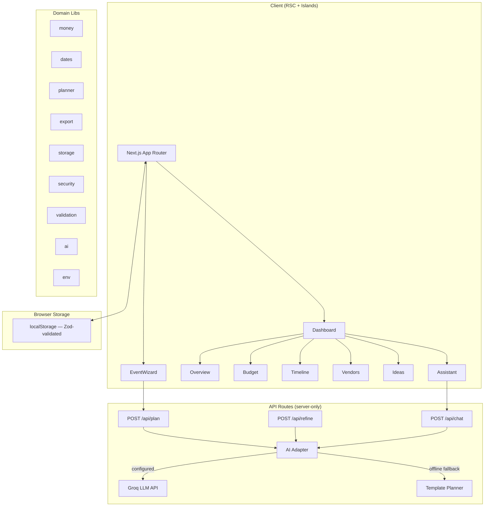

# Jashn — AI Celebration & Event Planner

> **AI-powered planning assistant for weddings, birthdays, and community events — built for Hack2skill PromptWars Challenge 5.**

[](https://github.com/your-org/jashn/actions)

---

## Overview

Jashn ("celebration" in Hindi/Urdu) helps you organise any celebration with:

- **Personalised AI-generated budgets, timelines, vendor checklists, and ideas** (via Groq LLM API with Llama 3.3)
- **Full template fallback** when no API key is present — every single feature works seamlessly offline
- **Multi-currency support** (INR, USD, EUR, GBP, AED) with `Intl.NumberFormat` and en-IN lakh/crore grouping
- **Export to JSON, CSV, ICS calendar, print, and formatted WhatsApp summary**
- **WCAG 2.2 AA accessible** — keyboard-only navigation, screen reader support, high contrast, reduced motion

## Architecture



## Quick Start

```bash
# 1. Clone and install
git clone <repo>
cd jashn
npm install

# 2. Set up environment (optional — works in offline template mode without it)
cp .env.example .env.local
# Add your GROQ_API_KEY from https://console.groq.com (free)

# 3. Run development server
npm run dev
# Open http://localhost:3000
```

## Environment Variables

| Variable       | Required | Default                   | Description                                                                   |
| -------------- | -------- | ------------------------- | ----------------------------------------------------------------------------- |
| `GROQ_API_KEY` | No       | —                         | Groq API key (free at console.groq.com). If absent, template planner is used. |
| `GROQ_MODEL`   | No       | `llama-3.3-70b-versatile` | LLM model to use for planning, chat, and refinement                           |

## Scripts

| Script                  | Description                              |
| ----------------------- | ---------------------------------------- |
| `npm run dev`           | Start development server                 |
| `npm run build`         | Production build                         |
| `npm run start`         | Start production server                  |
| `npm run lint`          | Run ESLint (zero warnings gate)          |
| `npm run format:check`  | Check Prettier formatting                |
| `npm run format`        | Auto-format with Prettier                |
| `npm run typecheck`     | TypeScript type check (`tsc --noEmit`)   |
| `npm run test`          | Run Vitest unit tests                    |
| `npm run test:coverage` | Unit tests + coverage report             |
| `npm run test:e2e`      | Playwright E2E tests                     |
| `npm run audit`         | npm security audit (prod deps only)      |
| `npm run bundle:audit`  | Verify API key absent from client bundle |
| `npm run verify`        | Run all CI checks                        |

## Deployment

### Vercel (Recommended)

```bash
npm i -g vercel
vercel --prod
# Optional: Set GROQ_API_KEY in Vercel dashboard → Project Settings → Environment Variables
```

### Docker / Cloud Run

```bash
# Build image
docker build -t jashn .

# Run locally
docker run -p 3000:3000 -e GROQ_API_KEY=your_key jashn

# Deploy to Cloud Run
gcloud run deploy jashn \
  --image us-central1-docker.pkg.dev/YOUR_PROJECT/jashn/jashn:latest \
  --platform managed \
  --region us-central1 \
  --allow-unauthenticated \
  --set-env-vars GROQ_API_KEY=your_key \
  --memory 512Mi \
  --min-instances 0 \
  --max-instances 10
```

## Security Model

See [docs/SECURITY.md](docs/SECURITY.md) for the full threat model.

Key measures:

- `GROQ_API_KEY` is server-only; verified absent from client bundle via `npm run bundle:audit`
- Nonce-based CSP, HSTS, X-Frame-Options, Permissions-Policy headers via middleware
- Per-IP token-bucket rate limiting (429 + Retry-After)
- Zod validation on all inputs, LocalStorage, and AI outputs
- Prompt injection hardening: delimited user data, fixed system instruction, JSON-only output
- CSV formula injection guard; ICS escaping + line folding (RFC 5545)

## Accessibility Statement

Jashn targets **WCAG 2.2 AA** compliance:

- Skip link, landmark roles, single `h1` per page, ordered headings
- `fieldset`/`legend`, `label`/`htmlFor`, `aria-invalid`/`aria-describedby` on all form fields
- Error summary with focus management on failed submit
- WAI-ARIA Tabs with roving tabindex (arrows, Home, End)
- `aria-live="polite"` for async status; `role="alert"` for errors
- All SVG charts have accessible data table equivalents
- `prefers-reduced-motion` respected; minimum 44px touch targets
- Reflow tested at 320px / 400% zoom

## Problem Statement Traceability

| Requirement                                    | Feature                                      | Files                       | Tests                                   |
| ---------------------------------------------- | -------------------------------------------- | --------------------------- | --------------------------------------- |
| Organise weddings, birthdays, community events | Event type selector (Step 1)                 | `EventWizard.tsx`           | `planner.test.ts`, `validation.test.ts` |
| Budgets                                        | Budget tab with planned/actual/remaining     | `Dashboard.tsx`, `money/`   | `money.test.ts`                         |
| Timelines                                      | Timeline tab with dated tasks + ICS          | `Dashboard.tsx`, `dates/`   | `dates.test.ts`                         |
| Vendor checklists                              | Vendors tab with status workflow             | `Dashboard.tsx`             | `jashn.spec.ts`                         |
| Personalised ideas                             | Ideas tab: themes, menu, activities, favours | `Dashboard.tsx`, `planner/` | `planner.test.ts`                       |
| GenAI-powered                                  | Groq LLM API via POST /api/plan              | `ai/`, `api/plan/`          | `jashn.spec.ts`                         |
| Fallback without API key                       | Template planner                             | `planner/`                  | `planner.test.ts`                       |
| Multi-currency                                 | INR, USD, EUR, GBP, AED                      | `money/`                    | `money.test.ts`                         |
| Privacy & Local Storage                        | Full offline storage, no server persistence  | `storage/`                  | `storage.test.ts`                       |
